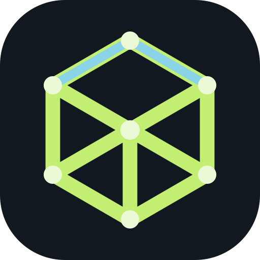
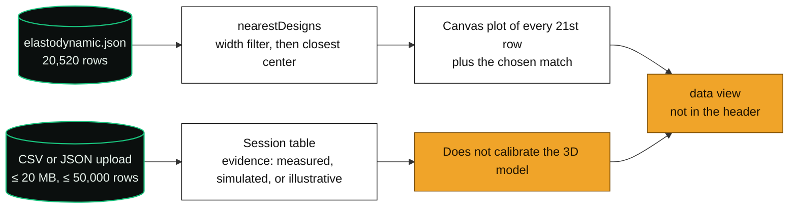
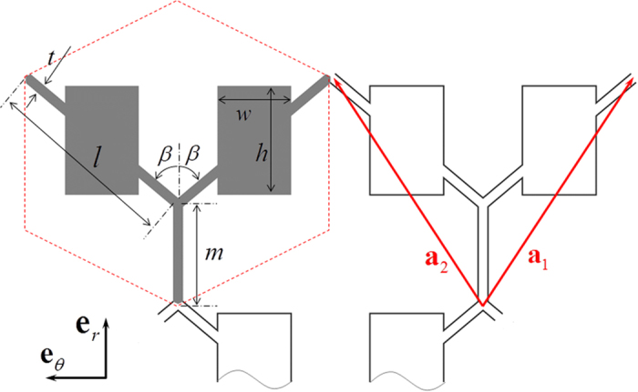
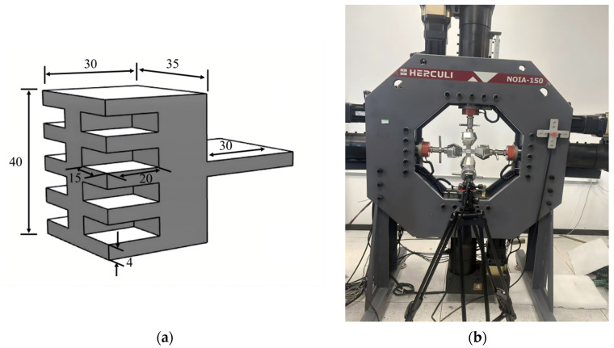

<p align="center">
  
</p>

<p align="center"><strong>🏆 Best Astra Build · Astra Commons KL</strong></p>

<p align="center">
  <strong>See the cell, the tiled field, and a use, with the paper still attached.</strong>
</p>

<p align="center">
  <sub>48 families, three variants each. Procedural Three.js. The motion, and the modulus on screen, are teaching illustrations, not a solver.</sub>
</p>

<p align="center">
  
  
  
  
  
  
  
  
  
</p>

---

## ▍The problem

A paper gives you a unit cell and a number. A spec sheet gives you a material name. Neither puts the repeating geometry, a tiled field, and a recognizable use in one place, with the citation still one click away.

Matter Lab is that place, in the browser. You pick a family, change the variant and the base material, and watch a procedural model. Six of the scenes are product assemblies (shoe, wing, knee brace, helmet, skateboard, motor mount). The rest are lab-style demonstrators. Every family links to a source. The moving parts are authored illustrations.

We'd rather be precise than impressive. Nothing here is finite-element analysis, a certified allowable, or manufacturing CAD.

## ▍The pipeline at a glance

```mermaid
flowchart LR
    classDef input fill:#0b0f0e,stroke:#19c37d,color:#e8f3ec,stroke-width:1.5px
    classDef stage fill:#ffffff,stroke:#111,color:#111,stroke-width:1px
    classDef output fill:#19c37d,stroke:#0b3d31,color:#04120d,stroke-width:1.5px

    CAT[("Catalog<br/>48 families × 3 variants<br/>lib/matter/catalog.ts")]:::input

    subgraph S1["01 · PICK"]
      direction TB
      A1["Family, variant,<br/>allowed base material"]:::stage
      A2["Field guide card<br/>stays a separate photograph"]:::stage
    end

    subgraph S2["02 · DRAW"]
      direction TB
      B1["Procedural cell<br/>and tiled field"]:::stage
      B2["Three.js WebGL<br/>or CPU rasterizer"]:::stage
    end

    subgraph S3["03 · READ"]
      direction TB
      C1["Structure"]:::stage
      C2["Behavior<br/>schematic motion"]:::stage
      C3["In the real world<br/>authored scene"]:::stage
    end

    CAT --> S1 --> S2 --> S3
    S3 --> OUT{{"Lesson copy + HTTPS source<br/>numbers labeled illustrative"}}:::output
```



| Stage | Where it lives | What it decides |
| --- | --- | --- |
| **Catalog** | `lib/matter/catalog.ts`, `lib/matter/expansion.ts` | 18 core families plus 30 expansion families. Each has three variants and a matching lesson. `tests/application-models.ts` asserts the count. |
| **Draw** | `lib/matter/geometry.ts`, `components/matter/Scene.tsx` | Builds the cell in code. WebGL when `WebGLRenderer` constructs; otherwise `SoftwareRenderer`, a geometric rasterizer. The fallback label is "Software 3D preview · Enable WebGL for full lighting". |
| **Modes** | `components/matter/Studio.tsx` | Structure, Behavior, or In the real world. Application mode can explode parts and change playback speed. The viewport reads "Drag to orbit · Scroll to zoom". |
| **Sources** | `lib/matter/learning.ts`, `lib/matter/expansion-references.json` | A photograph or figure is never the mesh. Expansion families use files under `public/images/expansion/`. Core families point at remote HTTPS images. |
| **Evidence file** | `public/data/elastodynamic.json` | 20,520 computer-tested 2D designs: 15-character geometry, band-gap center (Hz), band-gap width (Hz). The explorer calls each row a simulated structure. Searched by `nearestDesigns` in `lib/matter/research.ts` (top 5, O(n·5)). |

The header you can click has two tabs: **Material studio** and **Field guide**. A third view, `tab === "data"`, renders `ResearchExplorer` plus CSV/JSON import. Nothing in the current UI calls `setTab("data")`, so that view is implemented and not linked.



Three types stay separate in the catalog and the scenes: `latticeDefinition` (topology), `reportedObservation` (the cited dataset and paper links), and `illustrationProfile` (motion and color). `docs/ARCHITECTURE.md` describes a further backend (signed uploads, Parquet, a query API). That file marks itself **proposed**. The running app does not implement it. `db/`, `worker/`, and `examples/d1/` are unused starter files. Imports stay in component state for the session.

### Six product assemblies

These are the recognizable products. Motion is scripted. Dimensions fit the teaching scene, not a CAD drawing. `npm run test:models` builds every core application scene at explosion `0`, `0.35`, and `1`, and at eight times, and checks finite transforms.

| Family | Variants | Scene in code | What the checks cover |
| --- | --- | --- | --- |
| **Gyroid** | Sheet, skeletal, graded | Running-shoe midsole (`Shoe.ts`, `Athlete.ts`) | 240 gait samples: fixed arm length, outsole contact in stance, no ground penetration in swing, continuous toe-off |
| **Octet truss** | Uniform, graded, anisotropic | Aircraft wing core | Horizontal tail tips sweep aft, away from the +X nose |
| **Re-entrant** | Cell, deep, graded | Knee-protection insert | 120 flexion poses; ankle stays on the shoe collar |
| **Kelvin cell** | Uniform, thick, graded | Cycling-helmet liner (`Helmet.ts`) | Constant gravity `98.1` scene-units/s² (1 unit = 0.1 m), drop from `1.25`, restitution `0.28`, no penetration, ball at rest by t = 1 s. Display rate is 0.28 physical seconds per animation second. Not an injury model. |
| **Honeycomb** | Hexagonal, elongated, graded | Skateboard deck core | Same finite-geometry pass as the other scenes |
| **Local resonator** | Single, dual, graded mass | Motor mount | Rotating drive and a moving internal mass. Same geometry pass. |

### Twelve more core scenes

Same studio, same three modes. These application scenes are lab demonstrators, not the six products above.

| Family | Category | Application line in the catalog |
| --- | --- | --- |
| Dielectric metalens | Optical | Compact imaging optic |
| Microwave cloak | Electromagnetic | Microwave scattering-control shell |
| Membrane absorber | Acoustic | Low-frequency noise-control panel |
| Thermal cloak | Thermal | Temporary hot-spot protection |
| Topological edge lattice | Wave | Robust waveguide |
| Magnetic flux shell | Magnetic | Magnetic-sensor enhancer |
| Hyperbolic multilayer | Optical | Near-field optical transport demonstrator |
| Chiral helix polarizer | Optical | Polarization-sensitive optical filter |
| Space-coiling labyrinth | Acoustic | Compact acoustic wave-shaping panel |
| Radiative-cooling film | Thermal | Passive-cooling roof-film demonstrator |
| Seismic resonant metawedge | Seismic | Ground-wave management research model |
| Water-wave plate array | Hydrodynamic | Wave-tank guiding experiment |

### Thirty expansion families

Qualitative only. Specialised controls replace the modulus readout with the word **Qualitative**. Each entry has three variants, a limitation sentence, and an HTTPS source. Reference photos for these 30 live in the repo; the model test also imports `tests/expansion-models.ts` and `tests/field-visuals.ts`.

| Family | Category | Tag in the catalog |
| --- | --- | --- |
| Pentamode lattice | Mechanical | Stiff in compression, compliant in shear |
| Rotating squares | Mechanical | Rigid tiles joined by compliant corners |
| Chiral honeycomb | Mechanical | Ring rotation through tangent ligaments |
| Miura origami | Mechanical | Folded facets that deploy together |
| Kirigami ribbon sheet | Mechanical | Cuts release out-of-plane motion |
| Bistable beam | Mechanical | Snap-through between two shapes |
| Tensegrity cell | Mechanical | Isolated struts held by tension network |
| Spinodal shell | Mechanical | Smooth random-looking connected shell |
| Chainmail sheet | Mechanical | Interlocking links that drape together |
| Bimetal thermal-expansion strip | Mechanical | Bonded layers curve with temperature change |
| Negative-index split-ring array | Electromagnetic | Coupled electric and magnetic resonators |
| Epsilon-near-zero channel | Electromagnetic | Wave phase through a narrow throat |
| Space-time modulated metasurface | Electromagnetic | Travelling bias over resonant cells |
| Photonic-bandgap crystal | Optical | Periodic pillars block selected light paths |
| Quasi-BIC metasurface | Optical | Asymmetry releases a trapped resonance |
| Phase-change metasurface | Optical | Reconfigurable GST optical pixels |
| Liquid-crystal metasurface | Optical | Field-addressed director orientation |
| Huygens metasurface | Optical | Paired optical responses shape a wavefront |
| Structural-colour pillar array | Optical | Colour from patterned silicon |
| Graphene absorber | Optical | Gated two-dimensional resonant pattern |
| Helmholtz resonator array | Acoustic | Cavities coupled through narrow necks |
| Acoustic hologram | Acoustic | Tile delays shape a sound field |
| Ventilated metamaterial silencer | Acoustic | Noise control around open airflow |
| Bubble metascreen | Acoustic | Soft bubble sheet with guided spacing |
| Acoustic Luneburg lens | Acoustic | Graded cells focus incident sound |
| Thermal concentrator | Thermal | Fan sectors guide conductive heat |
| Thermal diode | Thermal | Directional heat-flow research concept |
| Selective thermal emitter | Thermal | Patterned metal over dielectric |
| Magnetically programmable elastomer | Magnetic | Fixed magnetization drives soft shape |
| Piezo-shunted beam | Electromechanical | Electrical circuit changes vibration coupling |

Categories across the full atlas: Mechanical, Acoustic, Optical, Electromagnetic, Thermal, Wave, Magnetic, Seismic, Hydrodynamic, Electromechanical.

For families **without** a specialised control, the studio still prints a number. It is a slider formula, not a measurement: relative density is capped at 0.65, then a Voigt/Reuss mix of the two base moduli is multiplied by density to the power 1 (octet) or 2 (everything else), then by 0.3. Non-mechanical families in that group show a 0–5 "qualitative response index" instead of MPa. Export writes `"evidence": "illustrative"`. Opening an imported row in 3D sets geometry sliders only, and the toast says imported measured properties are not used to calibrate the model.

## ▍The demo

This repository has no captured screenshot of the running studio. Run it locally. The pictures below are published reference figures shipped for the field guide. They are not renders of this app. `lib/matter/learning.ts` says so: a photograph must not be mistaken for a simulated result.

<table>
  <tr>
    <td width="50%" valign="top">
      
      <br />
      <sub><b>Pentamode.</b> Mohammadi et al., 2020, Fig. 2. Additively manufactured specimens. The studio cell is a simpler teaching model. Credit and reuse terms are in <code>lib/matter/expansion-references.json</code>.</sub>
    </td>
    <td width="50%" valign="top">
      
      <br />
      <sub><b>Miura origami.</b> Experimental test-rig photograph, Polymers (2026), Fig. 4, CC BY 4.0. The studio animates crease geometry. It does not reproduce this fixture.</sub>
    </td>
  </tr>
</table>

Thirty expansion families have a local thumbnail and a local display image (`public/images/expansion/thumbs/*.webp`, `public/images/expansion/display/*.webp`). `tests/performance-contract.test.mjs` asserts both folders contain 30 files, thumbnails under 300,000 bytes combined and displays under 3,000,000 bytes combined. Core-family photos are remote URLs in `lib/matter/learning.ts`, not files in this repo.

**In the studio, once it is running:**

- Structure library: search and category filter over all 48 families.
- Structure / Behavior / In the real world. Wireframe and cutaway toggles. Play and pause.
- On application scenes without specialised controls: explode (0–100%, step 5) and speed (0.3×–1.5×).
- Field guide: one family at a time, reference image, source link, and a button back into the studio.
- Glossary: 282 entries in `lib/matter/glossary.json`. Dotted terms and text selection. No model call.

**Controls on screen:** drag to orbit, scroll to zoom, play / pause. There is no committed keyboard map for the main viewport.

The UCI landing page is [doi.org/10.24432/C5ZS5D](https://doi.org/10.24432/C5ZS5D). The file in this repo is the dataset. The in-app explorer that plots it is the unlinked `data` view described above. The canvas comment says hundreds of marks, because the plot keeps rows whose index is a multiple of 21 (978 of 20,520), not every row.

The field guide also lists four external datasets from `lib/matter/frontier-datasets.json` (checked 2026-09-17). They are links, not files in this repo. The file's own scope note: "simulation" means the released records are computationally generated.

## ▍Run it

Requirements: Node.js `>=22.13.0` (`package.json` `engines`), npm, a browser. WebGL is the intended renderer. If constructing `WebGLRenderer` throws, the CPU rasterizer takes over. No API key.

Scripts under `scripts/` are bash. On Windows, use Git Bash or WSL. `npm run build` calls `scripts/build-verified.sh`, which needs GNU `timeout` and a finished `npm install` so `vinext` is on disk.

```sh
git clone https://github.com/bede-lau/matter.git
cd matter
npm install
npm run dev
```

Vite is configured with `host: "0.0.0.0"` and no fixed port. The dev server prints the URL. Vite's default is `http://localhost:5173`.

| Command | What it runs |
| --- | --- |
| `npm run dev` | Vite dev server (`WRANGLER_LOG_PATH=.wrangler/wrangler.log`) |
| `npm run build` | `scripts/build-verified.sh`: `vinext build` under GNU `timeout` (default 3 minutes) |
| `npm start` | `vinext start` after a build |
| `npm run test:models` | `node scripts/check-models.mjs`. Bundles `tests/application-models.ts`, which also imports the expansion and field-visual checks |
| `npm test` | `npm run build`, then `node --test tests/*.test.mjs` |
| `npm run lint` | ESLint via `scripts/sites-env.sh`, ignoring `dist` and `.next` |
| `npm run db:generate` | `drizzle-kit generate`. The studio does not use this database |
| `npm run install:ci` | `scripts/install-ci.sh` |

`npm run test:models` is a geometry and invariant script, not a browser session. It checks 48 unique families, three variants and matching lessons each, HTTPS sources, the 240-sample gait, the helmet drop, 120 knee poses, the aircraft tail, and 150 ranking comparisons of `nearestDesigns` against a sort on a 2,500-row fixture. It does not validate lattice physics or human biomechanics.

`docs/IMPLEMENTATION.md` records an earlier local Node timing of the ranker on the real 20,520-row file (0.182 ms/query versus 1.908 ms/query for a filter-and-sort). That number is not re-measured by `npm run test:models`, and the note says it is query work, not browser frame time. This README does not claim a frame rate.

**No key for the studio.** There is no model API. `WRANGLER_LOG_PATH` in the npm scripts is a local log path, not a secret. Do not commit `.env` files. `.openai/hosting.json` holds a hosting project id with `d1` and `r2` set to `null`; leave it out of docs and chat.

Imported rows, when the `data` view is opened, need `family`, `variant`, `material`, `cell_size_mm`, `strut_diameter_mm`, `source_url`, and `evidence` (`measured`, `simulated`, or `illustrative`). Optional: `density_kg_m3`, `modulus_mpa`. The panel can download `matter-dataset-template.json`. Limits in code: 20 MB, 50,000 rows in the session, first 100 shown in the table, export includes all of them. Nothing is written to a server.

## ▍Repository map

```
matter/
├── app/
│   ├── layout.tsx                 metadata, icons, PWA manifest
│   ├── page.tsx                   renders Studio
│   └── globals.css
├── components/matter/
│   ├── Studio.tsx                 studio, field guide, unlinked data view
│   ├── Scene.tsx                  Three.js lifecycle, orbit, cutaway, wireframe
│   ├── SoftwareRenderer.ts        CPU fallback when WebGL construction throws
│   ├── FieldGuide.tsx             reference cards and source links
│   ├── ResearchExplorer.tsx       UCI band-gap search (data view only)
│   ├── ResearchPlot.tsx           one canvas draw of the row sample
│   ├── Glossary.tsx               282-term lookup
│   ├── MiniLattice.tsx            small previews, same WebGL-or-CPU choice
│   └── models/                    procedural scenes (shoe, wing, brace, helmet, …)
├── lib/matter/
│   ├── catalog.ts                 18 core families, then the 30 expansion families
│   ├── expansion.ts               qualitative expansion copy and sources
│   ├── geometry.ts                parametric cells
│   ├── learning.ts                field-guide cards
│   ├── research.ts                nearestDesigns
│   ├── glossary.json
│   ├── expansion-references.json  figure credits and licenses
│   └── frontier-datasets.json     four external dataset links
├── public/
│   ├── data/elastodynamic.json    20,520 UCI rows
│   ├── data/research.json         separate concept-learning bibliography
│   ├── images/expansion/          source figures, display webps, thumbs
│   ├── fonts/                     self-hosted Inter variable woff2
│   └── icon-512.png               mark used above
├── tests/                         model script plus node:test files
├── scripts/                       install, build, lint wrapper, model check
├── docs/
│   ├── ARCHITECTURE.md            proposed. Not the running data path.
│   ├── IMPLEMENTATION.md          what was built, checked, and left out
│   └── licenses/ReUI-MIT.md
├── db/  worker/  examples/d1/     starter files, unused by the studio
└── package.json
```

| Doc | |
| --- | --- |
| [docs/ARCHITECTURE.md](docs/ARCHITECTURE.md) | Proposed PRD and data platform. Ingestion record shape, evidence grades A–D, and the explicit non-goals (no FEA, no material recommendation, no manufacturing export). |
| [docs/IMPLEMENTATION.md](docs/IMPLEMENTATION.md) | Delivered prototype, visual-QA limits, product scenes, and the continuation list. |
| [docs/licenses/ReUI-MIT.md](docs/licenses/ReUI-MIT.md) | MIT license for the ReUI patterns copied locally. |
| [vendor/shadcn-tailwind-4.13.0.LICENSE.md](vendor/shadcn-tailwind-4.13.0.LICENSE.md) | Vendor license note for the shadcn Tailwind file. |
| [public/data/research.json](public/data/research.json) | Nine-family concept catalog with `evidence_status`. Not the 3D atlas and not the UCI file. |

## ▍What this is, and isn't

- **Illustrations, not predictions.** Procedural meshes and authored motion. The on-screen MPa range is the slider formula above. `docs/ARCHITECTURE.md` forbids presenting slider motion as a measured property.
- **Not a solver.** No FEA, homogenization, uncertainty, or domain of validity. `docs/IMPLEMENTATION.md` lists those as future work, not as features.
- **Not GPU-validated.** The CPU path exists so a browser with WebGL disabled can still show geometry. Materials, shadows, and clipping on a real GPU were not signed off in that note. Do not describe the build as photorealistic.
- **The runner is procedural.** Contoured body, two-link leg IK, clothing, and shoes are code. There is no licensed scanned character and no authored glTF clip in the repo.
- **The dataset is a computer model of 2D cells.** The explorer calls each row a simulated structure and says the file is separate from the 3D product lessons. The count in-file is 20,520 data rows. The UCI page reports 20,521 instances because that count includes the CSV header. The note is in `public/data/elastodynamic.json`.
- **The research UI is unwired.** Explorer, canvas plot, and import exist. The header does not open them.
- **Session uploads are not a database.** No auth, no durable store, no scientific validation of imported numbers. Drizzle generation is a leftover script.
- **Blender and Unity are not in the loop.** `docs/ARCHITECTURE.md` records optional local MCP authoring steps. They are not runtime dependencies, and this app does not load `.blend` or Unity scenes.
- **Evidence grades A–D** are specified in the proposed architecture doc. The running import check accepts only `measured`, `simulated`, and `illustrative`.
- **No project license file.** Code in this repo is not marked CC BY. The UCI dataset is CC BY 4.0. Field-guide figures keep the license on each entry in `expansion-references.json` (CC BY 4.0, CC BY-NC 4.0, or an arXiv reuse note). Check the entry before reusing an image.

## ▍Credits

| | |
| --- | --- |
| 3D | [Three.js](https://github.com/mrdoob/three.js) 0.185 |
| App shell | React 19.2, Next.js 16.2, [Vinext](https://github.com/cloudflare/vinext) 0.0.50, Vite 8, Tailwind CSS 4.2 |
| UI primitives | Radix, Base UI, and local ReUI patterns (MIT, Keenthemes; see `docs/licenses/ReUI-MIT.md`) |
| Icons | [Lucide](https://lucide.dev/) |
| Type | Self-hosted Inter, files in `public/fonts/`, package `@fontsource-variable/inter` |
| UCI dataset | Ogren, Chen, Brinson, Bastawrous, Rudin, and Daraio (2021), [10.24432/C5ZS5D](https://doi.org/10.24432/C5ZS5D), CC BY 4.0 |
| Gyroid source linked from the catalog | [NASA NTRS 19700020472](https://ntrs.nasa.gov/citations/19700020472) |
| Expansion figures | Per-image credit, source URL, and license in `lib/matter/expansion-references.json` |
| Other family sources | HTTPS link on each family in `lib/matter/catalog.ts` and `lib/matter/expansion.ts` |

<p align="center">
  <sub>Geometry-driven learning. Sources, not certainty.</sub>
</p>
